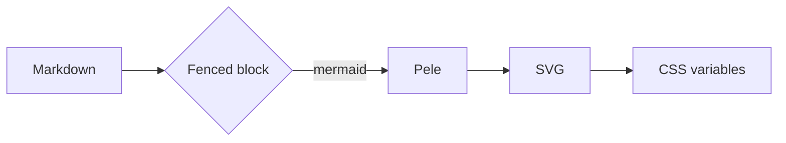
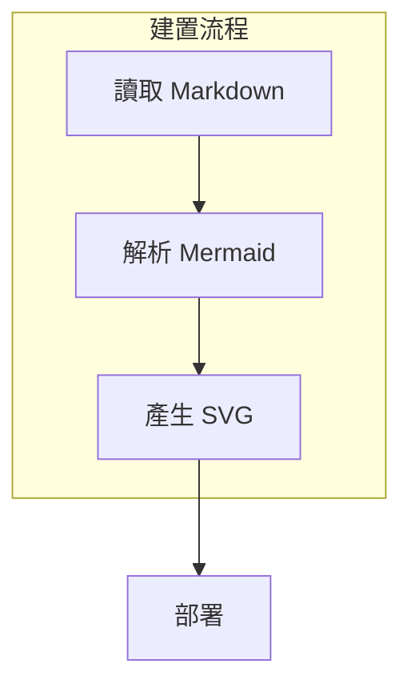
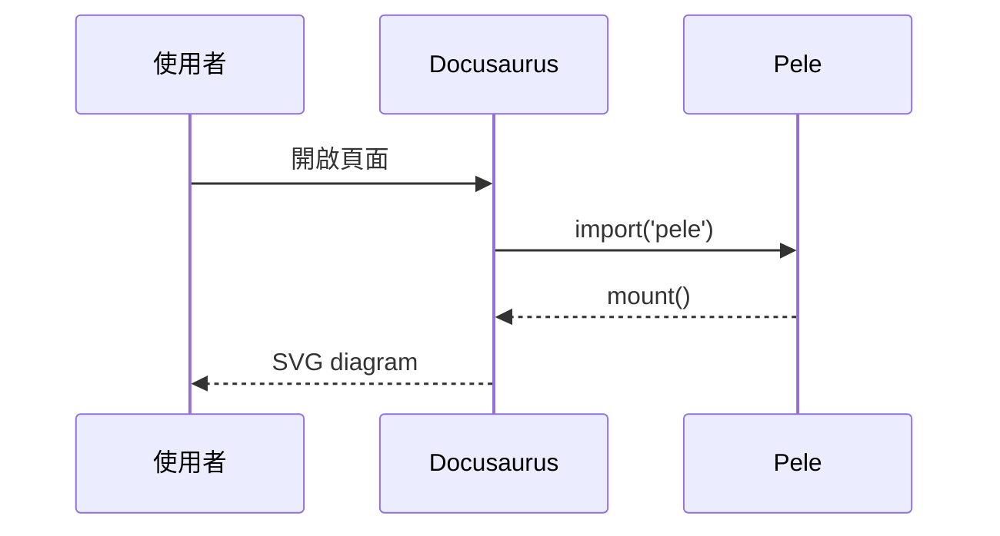
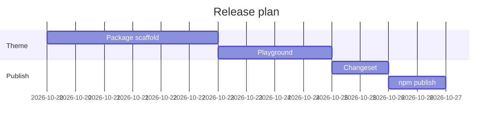
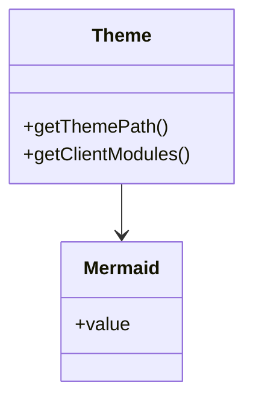
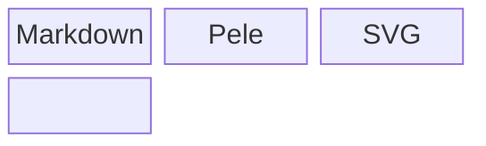
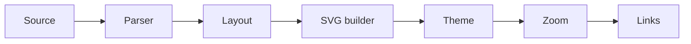

# docusaurus-theme-pele

This playground renders every diagram type used by kywk.me with Pele instead of
Mermaid. Toggle the color mode to check that diagrams restyle without a
re-render.

## Flowchart

## Flowchart with subgraph and CJK labels

## Sequence

## Gantt

## Class

## Block

## Wide diagram

