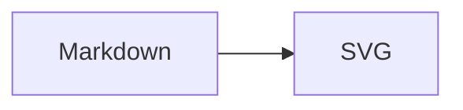

# docusaurus-theme-pele

Render Mermaid diagrams in [Docusaurus](https://docusaurus.io) with
[Pele](https://pele.run): a small, synchronous Mermaid renderer that outputs
themeable SVG.

- **Smaller than Mermaid**: about 250 KB gzip for all diagram types (Mermaid 11
  is roughly 790 KB). Import Pele's `core` entry directly if you need per-type
  bundles.
- **Themeable with CSS**: light/dark switching never re-renders a diagram.
- **Synchronous**: no `mermaid.initialize()`, no global singleton, no DOM
  artifacts on parse errors.
- **Responsive**: diagrams re-layout to the container width and can show zoom
  controls.

Pele targets Mermaid 12.1 syntax with its own layout and visual style. Diagrams
will not look identical to Mermaid's output.

## Requirements

| Dependency | Version |
| --- | --- |
| Docusaurus | 3.8 or newer (tested with 3.10) |
| React | 18 or 19 (tested with 19.2) |
| Node.js | 20.19 or newer |
| Pele | 1.7 (installed as a dependency) |

## Install

```bash
npm install docusaurus-theme-pele
```

## Usage

Enable Mermaid fenced blocks and add the theme:

```ts
// docusaurus.config.ts
export default {
  markdown: {
    mermaid: true,
  },
  themes: ['docusaurus-theme-pele'],
};
```

Remove `@docusaurus/theme-mermaid` from `themes` if you were using it. You can
also remove the `mermaid` and `@mermaid-js/layout-elk` packages.

> Docusaurus applies themes in order, and the last theme wins. If you keep
> `@docusaurus/theme-mermaid`, place `docusaurus-theme-pele` after it.

Then write diagrams as usual:

````md

````

## Options

```ts
// docusaurus.config.ts
export default {
  themeConfig: {
    pele: {
      // 'auto' (default) shows zoom controls only when a diagram is scaled down
      zoom: 'auto',
      className: 'my-diagram',
    },
  },
};
```

`zoom` accepts `true`, `false`, `'auto'`, or Pele's `ZoomOptions`
(`always`, `maxScale`, `controls`, `labels`).

## Theming

The theme maps Pele's CSS variables to Docusaurus' `--ifm-*` variables, so
diagrams follow your palette and switch with dark mode automatically. In light
mode, diagrams use `--ifm-color-primary-darker` for accents so labels on
colored shapes stay readable; override `--pele-accent` if you want the exact
brand color.

Override any variable on `.docusaurus-mermaid-container` or on a single diagram:

```css
.docusaurus-mermaid-container {
  --pele-accent: #205ea6;
  --pele-radius: 8px;
}
```

See [Pele theming](https://pele.run/theming) for the full variable list.

## Compatibility notes

- `themeConfig.mermaid` is not used. Configure the renderer through
  `themeConfig.pele`.
- ELK layouts are not supported. Remove `@mermaid-js/layout-elk` unless another
  package needs it.
- Some Mermaid-only features (for example `%%{init}%%` theme overrides) are
  partially supported or ignored. See
  [Pele compatibility](https://pele.run/compatibility).
- Diagrams render on the client. Pages render an empty container during static
  generation, like `@docusaurus/theme-mermaid` does today.
- Invalid Mermaid source is displayed as an error inside the diagram container
  instead of breaking the page.

## Development

```bash
pnpm install
pnpm --filter docusaurus-theme-pele build
pnpm --filter docusaurus-theme-pele test
pnpm playground
```

## License

MIT
